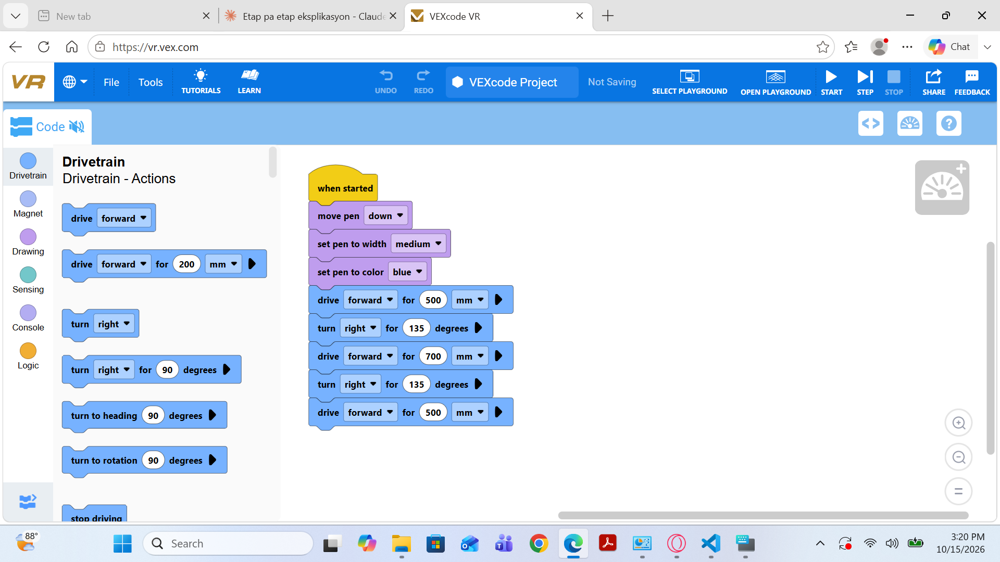
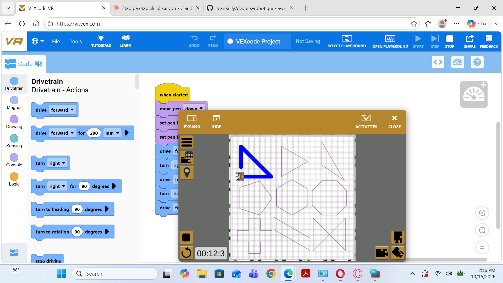

# Devoir 1 — Robot suiveur de ligne

## Objectif
Programmer le robot virtuel pour qu'il suive automatiquement une ligne tracée au sol.

## Outils utilisés
- VEXcode VR (https://vr.vex.com)
- Terrain : Shape Tracer (le terrain « Line Tracking » n'est pas disponible dans la version gratuite de VEXcode VR)

## Fonctionnement
le robot virtuel suive une ligne exacte 

## Résultats

### Captures d'écran

