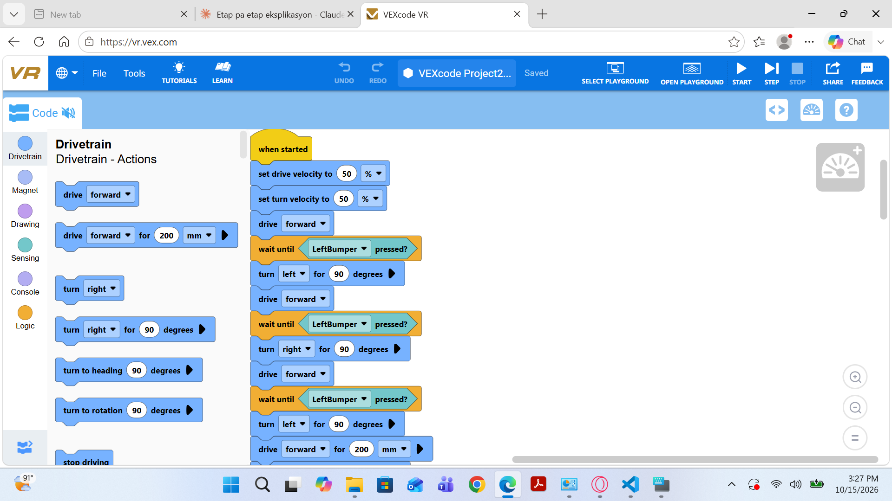
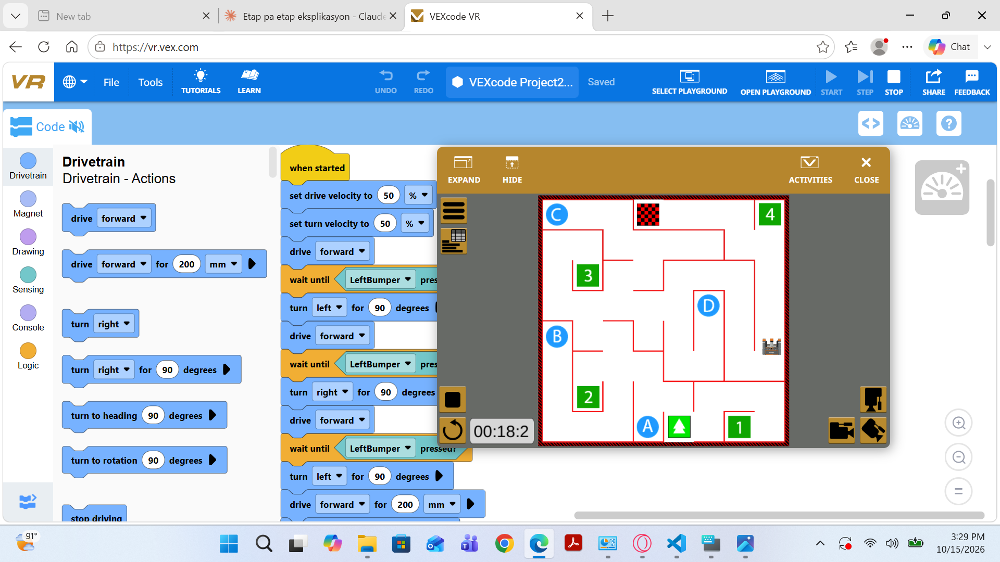

# Devoir 2 — Robot évitant les obstacles

## Objectif
Programmer le robot virtuel pour qu'il détecte un obstacle, s'arrête, tourne, puis continue sa route automatiquement.

## Outils utilisés
- VEXcode VR (https://vr.vex.com), programmation par blocs
- Terrain : Wall Maze

## Fonctionnement
Le programme s'exécute dans une boucle infinie. À chaque tour, le robot lit ses capteurs :
- si un obstacle est détecté, il s'arrête, tourne, puis repart ;
- sinon, il avance tout droit.

Le robot suit ainsi trois étapes répétées : mesurer, décider, agir.

## Résultats
Le robot détecte les murs du labyrinthe et change de direction pour les éviter.
Limite constatée : dans les couloirs étroits, il tourne plusieurs fois de suite et ne résout pas le labyrinthe.
Le capteur de distance affichait 999 mm même contre un mur, c'est pourquoi un autre capteur a été utilisé.

### Captures d'écran

