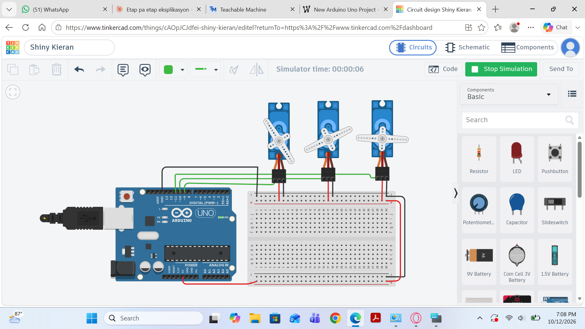

# Devoir 3 — Bras robotique à plusieurs degrés de liberté

## Objectif
Construire un petit bras robotique avec 3 servomoteurs et le programmer pour atteindre des positions précises.

## Composants et outils
- Tinkercad Circuits (https://www.tinkercad.com)
- 1 carte Arduino Uno R3
- 3 micro servomoteurs

## Fonctionnement
Le bras possède **3 degrés de liberté**, un par servomoteur :

| Servomoteur | Broche | Rôle |
|---|---|---|
| Servo 1 | 9 | Base : rotation gauche/droite |
| Servo 2 | 10 | Épaule : lever et baisser le bras |
| Servo 3 | 11 | Pince : ouvrir et fermer |

Le code ([code.ino](code.ino)) utilise la bibliothèque `Servo`. Il envoie un angle à chaque servomoteur,
attend, puis passe à la position suivante : le bras se déplace d'une position à une autre en répétant la séquence.

## Résultats
Le bras exécute la séquence programmée dans la simulation.

Lien du projet Tinkercad :

### Captures d'écran

