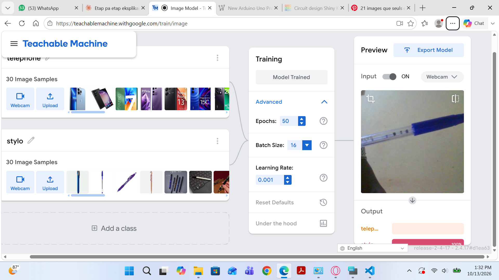

# Devoir 4 — Classificateur d'images simple

## Objectif
Entraîner un modèle d'intelligence artificielle à reconnaître 2 ou 3 objets différents grâce à la webcam.

## Outils utilisés
Google Teachable Machine (https://teachablemachine.withgoogle.com), projet « Image Project »

## Classes et données
- Classes : telephone et stylo
- Nombre d'images par classe : 30

## Fonctionnement
Chaque classe reçoit des images prises avec la webcam. Pendant l'entraînement, le modèle compare ces exemples
étiquetés et apprend les caractéristiques qui distinguent les classes. Ensuite, quand on lui montre un objet,
il indique la classe la plus probable avec un pourcentage de confiance.

## Résultats

Lien du modèle :

### Captures d'écran

