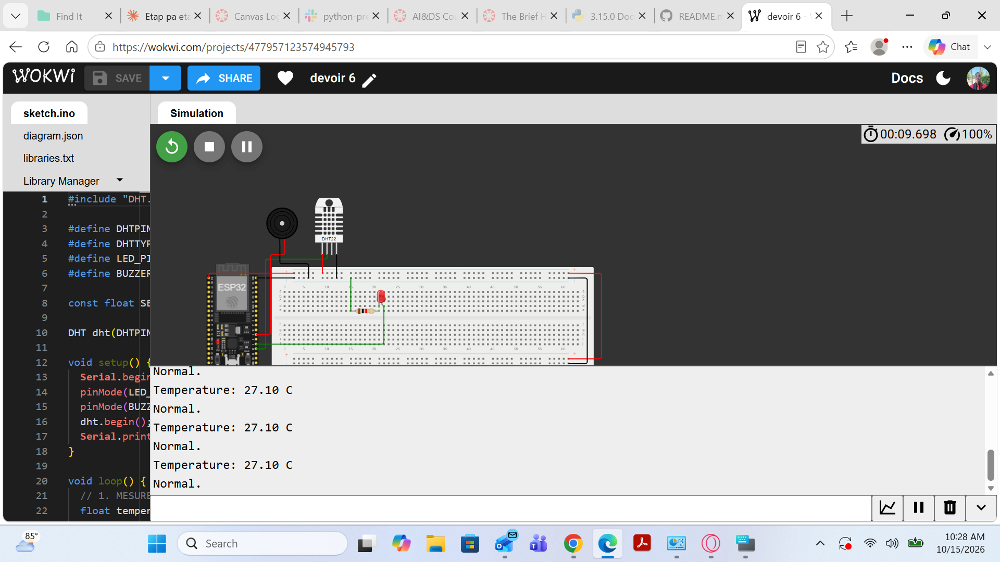

# Devoir 6 — Robot à décision intelligente

## Objectif
Construire un petit système ESP32 qui prend une décision automatique selon un seuil mesuré par un capteur.

## Composants et outils
- Wokwi (https://wokwi.com), simulateur en ligne
- ESP32
- Capteur de température DHT22 (GPIO 15)
- LED rouge avec résistance 220 Ω (GPIO 2)
- Buzzer (GPIO 4)
- Bibliothèque « DHT sensor library » (Adafruit)

## Fonctionnement
Le programme ([sketch.ino](sketch.ino)) lit la température toutes les 2 secondes et la compare à un seuil de **30 °C** :
- température supérieure à 30 °C : la LED s'allume et le buzzer sonne ;
- sinon : la LED et le buzzer restent éteints.

Les valeurs et les messages (« Normal » ou « ALERTE ») sont affichés dans le moniteur série.

## Résultats
- À 25 °C : la LED reste éteinte et le moniteur affiche « Normal ».
- À 35 °C : la LED s'allume, le buzzer sonne et le moniteur affiche « ALERTE ».

Lien du projet Wokwi :

### Captures d'écran

